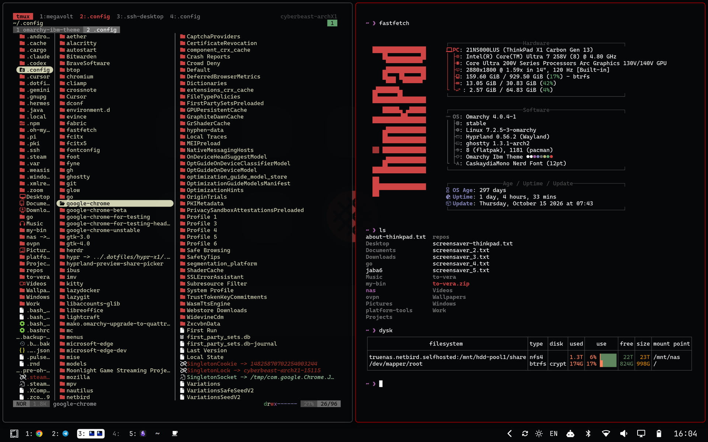

# Omarchy IBM Theme

A professional, high-contrast dark colorscheme for **Omarchy Linux**, inspired by
classic IBM / ThinkPad design: near-black surfaces, neutral greys and TrackPoint red.

> **Requires Omarchy Quattro (4.x).** The theme uses Quattro's semantic
> `colors.toml`, Lua Hyprland config and Omarchy shell overrides. For Omarchy 3.x,
> use the commit before `Support Omarchy Quattro (4.x)`.

---

## ✨ Preview


## 📦 Install

```bash
omarchy theme install https://github.com/deda/omarchy-thinkpad-theme
omarchy theme set thinkpad
```

A theme installed with `omarchy theme install` may not ship Lua, so Omarchy skips
`hyprland.lua`. The red window border still comes from `colors.toml`; for the
theme's gaps, rounding and groupbar too, clone the repo and symlink it instead:

```bash
git clone https://github.com/deda/omarchy-thinkpad-theme ~/repos/omarchy-thinkpad-theme
ln -s ~/repos/omarchy-thinkpad-theme ~/.config/omarchy/themes/thinkpad
omarchy theme set thinkpad
```

## 🎨 What's included

| File | Purpose |
|------|---------|
| `colors.toml` | Semantic Quattro palette. Omarchy generates alacritty, kitty, ghostty, foot, Neovim, Obsidian, VS Code, Helix and more from it |
| `hyprland.lua` | Gaps, rounding, shadows, red `#8b0000` borders and a minimal indicator-style groupbar |
| `shell.notifications.toml` | Lavender-bordered notifications |
| `shell.lock.toml` | Translucent lock-screen field with a red ring (dark red idle, TrackPoint red while typing, light red on a wrong password) |
| `shell.launcher.toml`, `shell.menu.toml` | Muted borders, lavender selection |
| `btop.theme` | Red-boxed btop |
| `tmux.conf`, `fastfetch.jsonc` | Opt-in extras, see below |
| `hyprland-preview-share-picker.css`, `warp.yaml`, `icons.theme`, `chromium.theme`, `keyboard.rgb` | App extras |

### Palette

| Role | Color | Role | Color |
|------|-------|------|-------|
| background | `#050709` | foreground | `#ffffff` |
| accent / blue | `#727272` | muted | `#4a4a4a` |
| red | `#d24646` | bright red | `#e99999` |
| green | `#66a773` | bright green | `#a3cfa8` |
| yellow | `#b4b47b` | bright yellow | `#dadaba` |
| magenta | `#8686ba` | bright magenta | `#afafd2` |
| cyan | `#a360a3` | bright cyan | `#c296c2` |
| window border | `#8b0000` | orange | `#d27a46` |

### Changes from the pre-Quattro version

- `colors.toml` moved from `color0`–`color15` to Quattro's semantic keys.
- Red and green are no longer swapped, so errors and alerts (lock screen, polkit,
  bar) render red and terminal ANSI colors are conventional.
- `hyprland.conf` became `hyprland.lua`.
- Waybar, mako, walker, wofi, swayosd and hyprlock files were removed (Quattro's
  shell replaces those apps); their styling lives on in the `shell.*.toml` overrides.
- Hand-written terminal, Neovim and Obsidian configs were removed in favor of
  Omarchy's generated ones.

## 🖥️ Optional: ThinkPad ASCII Logo (Fastfetch)

If you want your terminal to display a ThinkPad-style ASCII logo using `fastfetch`, you can use the following:

### 1. Horizontal logo (Fastfetch)
Save this to:
`~/.config/omarchy/branding/about.txt`

```bash

████████████████
   █▙▄▄▄▄▄▄▄▄▄▟█
    ▀▀▀▀▀▀▀▀▀▀▀
   ▄████████████
   █▙▄▄ █▙▄▄▄▄▟█
    ▀▀▀  ▀▀▀▀▀▀
▄███████▄
█▙▄▄▄▄▄▟█▄▄▄▄▄▄▄
▀▀▀▀▀▀▀▀▀▀▀▀▀▀▀▀
   █████▄ ▄█████
▄▄▄▄▄▄▄▄▟█▙▄▄▄▄▄
▀▀▀▀▀▀▀▀▀▀▀▀▀▀▀▀
   ▄████████████
   █▙▄▄▄▄▄▄▄▄▄▄▄
   ▀▀▀▀▀▀▀▀▀▀▀▀▀
▓▓ █████████████
    ▄▄▄▄▄▄▄▄▄▄▄▄
   █▛▀▀▀▀▀▀▀▀▀▀▀
████████████████
▄▄
██▄▄▄▄▄▄▄▄▄▄▄▄▄▄
██▀▀▀▀▀▀▀▀▀▀▀▀▀▀
▀▀   
```
### 2. Screensaver logo:
Save this to:
`~/.config/omarchy/branding/screensaver.txt`
```bash
             ▄▄
██████ ██   ▝██▘      ██    ████▄          ██
  ██   ██▗▄▖ ▄▄ ▄▄▗▄▖ ██ ▄▄ ██ ██  ▄▄▄  ▗▄▖██
  ██   ██▛██ ██ ██▛██ ██ ██ ██ ██ ██▀██ ██▜██
  ██   ██ ██ ██ ██ ██ ██▐█▌ ██▄██ ▀▀▗██ ██ ██
  ██   ██ ██ ██ ██ ██ ████  ██▀▀  ▗█▛██ ██ ██
  ██   ██ ██ ██ ██ ██ ██▐█▌ ██    ██ ██ ██ ██
  ██   ██ ██ ██ ██ ██ ██ ██ ██    ██▟██ ██▟██
  ▀▀   ▀▀ ▀▀ ▀▀ ▀▀ ▀▀ ▀▀ ▀▀ ▀▀    ▝▀▘▀▀ ▝▀▘▀
```

### 3. Red accents
Omarchy's fastfetch config colors the logo and hardware keys with ANSI green,
which is green in this palette. The theme ships `fastfetch.jsonc` (the stock
config with those switched to red). Install this theme-set hook to use it while
the theme is active and fall back to the stock config otherwise:

```bash
cat > /tmp/fastfetch-theme.sh <<'HOOK'
#!/bin/bash
THEME_FASTFETCH="$HOME/.local/state/omarchy/current/theme/fastfetch.jsonc"
USER_FASTFETCH="$HOME/.config/fastfetch/config.jsonc"
if [[ -f $THEME_FASTFETCH ]]; then
  [[ -e $USER_FASTFETCH && ! -L $USER_FASTFETCH ]] && exit 0
  mkdir -p "${USER_FASTFETCH%/*}"
  ln -nsf "$THEME_FASTFETCH" "$USER_FASTFETCH"
elif [[ -L $USER_FASTFETCH && $(readlink "$USER_FASTFETCH") == "$THEME_FASTFETCH" ]]; then
  rm "$USER_FASTFETCH"
fi
HOOK
omarchy hook install theme-set /tmp/fastfetch-theme.sh
```

## 🪟 Optional: tmux

Omarchy doesn't theme the tmux status bar, so this theme ships a `tmux.conf`.
Load it at the end of `~/.config/tmux/tmux.conf`:

```tmux
source-file -q ~/.local/state/omarchy/current/theme/tmux.conf
```

To restyle running sessions whenever you switch themes, install a theme-set hook:

```bash
cat > /tmp/tmux-theme.sh <<'HOOK'
#!/bin/bash
tmux list-sessions >/dev/null 2>&1 || exit 0
tmux source-file "$HOME/.config/tmux/tmux.conf" >/dev/null 2>&1 || true
HOOK
omarchy hook install theme-set /tmp/tmux-theme.sh
```
